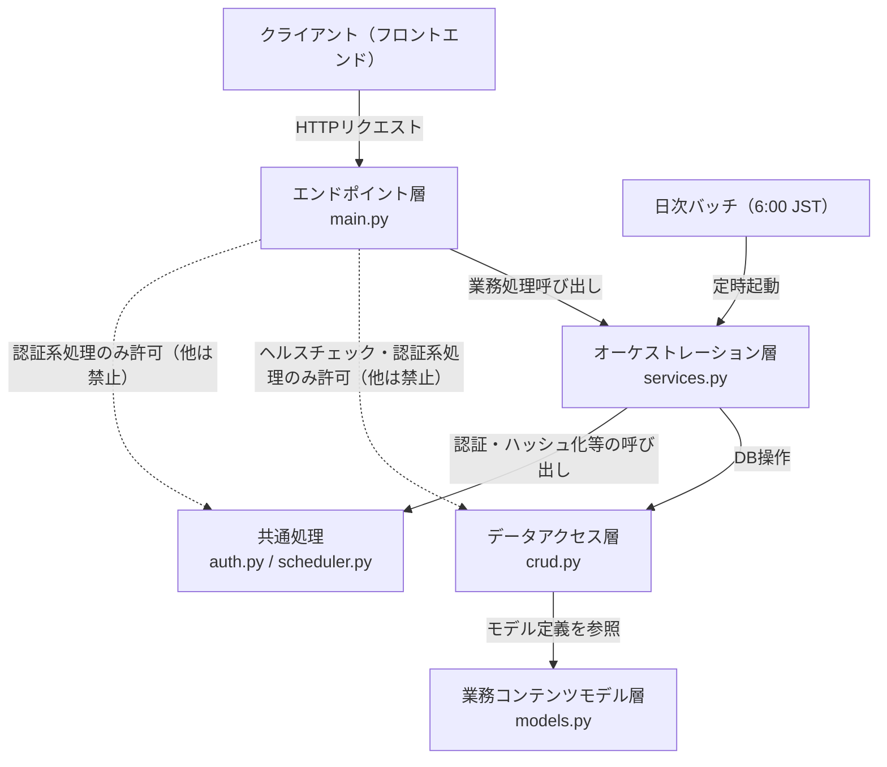

# バックエンドレイヤー構成方針

- **工程**: 設計工程
- **作成者**: Claude Sonnet 5
- **作成日**: 2026-10-24
- **最終更新日**: 2026-10-24

---

## ○概要

### 目的
- バックエンドの責務をレイヤー単位に分離し、呼び出し方向を一方向に限定することで、機能追加・変更時の影響範囲を局所化する。
- 各設計書（エンドポイント一覧・処理記述書等）が従うべき共通の構成・呼び出し規約を定める。

### 対象範囲
- `backend/app/`配下の全モジュール（`main.py`・`services.py`・`crud.py`・`models.py`・`schemas.py`・`auth.py`・`database.py`・`scheduler.py`）を対象とする。フロントエンド（`frontend/`配下）は対象外とする。

---

## ○構成

| 要素 | 役割 | 対応ファイル・ディレクトリ |
|---|---|---|
| エンドポイント層 | HTTPリクエストの受付とレスポンスの返却のみを行う。業務判断は持たない | `backend/app/main.py` |
| オーケストレーション層 | 状態遷移・重複判定・通知生成等の業務処理（ビジネスロジック）を行う。複数のデータアクセス層呼び出しを束ねる | `backend/app/services.py` |
| データアクセス層 | DB操作（Create／Read／Update／Delete）のみを行う | `backend/app/crud.py` |
| 業務コンテンツモデル層 | SQLAlchemyテーブルモデルの定義（データ構造のみ。ロジックは持たない） | `backend/app/models.py` |
| API入出力DTO | リクエスト・レスポンスのスキーマ定義（Pydantic） | `backend/app/schemas.py` |
| 共通処理 | 認証（トークン発行・検証）・パスワードハッシュ化・ロール検証・日次バッチ起動定義 | `backend/app/auth.py`、`backend/app/scheduler.py` |
| DB接続管理 | DBセッションの生成・管理 | `backend/app/database.py` |

- 呼び出し方向・レイヤー間の関係は以下のとおり。

- 禁止される関係（破線）：エンドポイント層からデータアクセス層・共通処理・業務コンテンツモデル層への直接呼び出しは、ヘルスチェック（DB等への疎通確認のみを行う処理）と認証・認可（auth）処理（ログイン・ログアウト・パスワード変更・自分の情報取得・有効ユーザー検証・ロール検証・初回パスワード変更検証）を除き禁止する。

---

## ○ルール

- レイヤー間の呼び出しは、エンドポイント層→オーケストレーション層→データアクセス層／共通処理／業務コンテンツモデル層の一方向のみとし、下位レイヤーから上位レイヤーを呼び返さない。エンドポイント層は下位レイヤーを直接呼び出さず、必ずオーケストレーション層を経由する。（`design`スキル「レイヤー構成」より原文引用）
    - 例外は次の2種に限る。これ以外の例外を、本方針書・各処理記述書で設けてはならない。
        - ヘルスチェック（DB等への疎通確認のみを行う処理）。オーケストレーション層を経由せず、エンドポイント層から疎通確認を行ってよい。
        - 認証・認可（auth）処理（ログイン（トークン発行）・ログアウト・パスワード変更・自分の情報取得・有効ユーザー検証・ロール検証・初回パスワード変更検証）。資格情報の検証・トークンの発行検証という性質上、業務（ドメイン）のオーケストレーションを持たないため、共通処理（`auth.py`）として一体的に扱い、エンドポイント層から直接呼び出す。データアクセス層への問い合わせが必要な場合も、オーケストレーション層を経由せず`auth.py`内で直接行い、1つの処理記述書（`設計書/認証・認可（auth）/`配下）内に完結して記載する。
    - 上記2種以外は、単純な参照等、業務処理を持たない処理も例外としない。下位レイヤーを呼ぶだけの場合も、オーケストレーション層に中継する処理を置いて経由する。
- リクエスト・レスポンスは物理名で記載し、メソッド呼び出しの引数は論理名のみを記載する。実装時は、呼び出し元の引数の論理名と、呼び出し先メソッドの設計書に記載の引数の論理名を紐づけて物理名を特定する。（`design`スキル「リクエスト／レスポンス」より原文引用）
- データアクセス層（`crud.py`）の戻り値はモデルをそのまま返却し、返却するクラス名のみ記載する（項目名までは記載しない）。オーケストレーション層（`services.py`）は、データアクセス層のレスポンスから必要な分のみ使用、またはエンドポイント層に返却する。エンドポイント層（`main.py`）は、オーケストレーション層のレスポンスをクライアントに返却する。（`design`スキル「リクエスト／レスポンス」より原文引用）
- 有効ユーザー検証・ロール検証・初回パスワード変更検証はFastAPIの依存性注入（`Depends`）により、認証が必要な各エンドポイント定義時に宣言する。実体は共通処理（`auth.py`）に置く。ロール検証・初回パスワード変更検証は、有効ユーザー検証の結果（ロール・初回パスワード変更要否フラグ）を用いて判定するのみで、データアクセス層を直接呼び出さない。
- 初回パスワード変更要否フラグ（`must_change_password`）が`true`のユーザーは、パスワード変更（F02）・ログアウト・自分の情報取得（変更要否フラグを画面に伝えるために必要）以外のエンドポイントを利用できない（機能要件「アクセス制御」参照）。上記3エンドポイントを除く認証必須の全エンドポイントは、有効ユーザー検証に加えて初回パスワード変更検証（`Depends`）を宣言する。
- 日次バッチ（期限通知・ノーショー自動取消）は、共通処理（`scheduler.py`）に置いたスケジューラがオーケストレーション層の処理を定時起動する。スケジューラ自体はエンドポイント層を経由しない常駐処理と位置づける。
- 業務コンテンツモデル層（`models.py`）はテーブル構造の定義のみを持ち、状態遷移・業務判断等のロジックを持たない。
- 「サーバー処理（main）」区分の処理記述書は、エンドポイント層とオーケストレーション層の処理を1つの処理記述書にまとめて記載する（サンプル`復習項目更新_v1.0.0.md`の記載形式を参考にする）。処理記述書内の「呼出先」がデータアクセス層（`crud.py`）の関数を指す場合も、実装時はオーケストレーション層（`services.py`）が当該呼び出しを行い、エンドポイント層（`main.py`）はオーケストレーション層の呼び出しのみを行う（上記レイヤー間呼び出しルールに従う）。データアクセス層の各関数は、再利用可能な単位でCRUD区分の処理記述書として別途作成する。

---

## ○対応状況

| 区分 | 意味 |
|---|---|
| サーバー処理（main） | エンドポイント層の処理記述書（`main.py`に対応） |
| CRUD | データアクセス層の処理記述書（`crud.py`に対応） |
| 認証・認可（auth） | 共通処理のうち認証・認可に関する処理記述書（`auth.py`に対応） |
| 通知（notification） | オーケストレーション層のうち通知生成・通知取得に関する処理記述書 |
| 起動時処理（startup） | アプリケーション起動時処理（初期管理者自動作成・スケジューラ起動定義）の処理記述書 |

| 区分 | 対象 | 備考 |
|---|---|---|
| サーバー処理（main）・CRUD | F01〜F17全機能のエンドポイント・DB操作 | 機能群単位（設計（共通）以外の4バックログ）のフォルダに格納する |
| 認証・認可（auth） | ログイン（トークン発行）／ログアウト／パスワード変更（F01・F02）／自分の情報取得／有効ユーザー検証／ロール検証／初回パスワード変更検証 | 設計（共通）バックログで作成する |
| 通知（notification） | 通知登録（承認・却下・取消・新規申請・返却期限の各通知生成）／通知一覧取得（F08） | 設計（共通）バックログで作成する |
| 起動時処理（startup） | 初期管理者アカウント自動作成／日次バッチ（期限通知・ノーショー自動取消）起動定義 | 設計（共通）バックログで作成する |

---

## ○根拠・関連資料

- レイヤー構成・リクエスト／レスポンスの原則：`design`スキル（[design/SKILL.md](../.claude/skills/design/SKILL.md)）
- フォルダ構成：要件定義書「フォルダ構成」
- 技術スタック：要件定義書「技術スタック」
- 機能一覧・アクセス制御：要件定義書「機能一覧」「機能要件」
